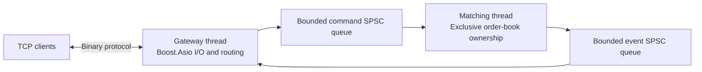

# llmatch — Low-latency C++ matching service

[](https://github.com/Owenqi666/low-latency-matching/actions/workflows/ci.yml)

A C++20 order-matching engine and asynchronous TCP service for exploring
latency, concurrency and correctness under load. Clients submit orders, receive
trade events and best bid/offer updates. The repository also includes an
independent offline Nasdaq ITCH 5.0 visible-book reconstructor.

The engineering focus is explicit ownership, bounded queues, reproducible
measurements and independent validation of results.

[Architecture](#architecture) · [Build and demo](#build-and-demo) ·
[Validation](#validation) · [Measurements and decisions](#measurements-and-decisions) ·
[Development guide](docs/development.md)

## What it implements

- **Deterministic matching:** price-time priority, limit orders, market IOC
  orders, partial fills and owner-checked cancellation, using integer prices
  and quantities.
- **A networked service:** Boost.Asio TCP gateway, binary framing, maker/taker
  event routing, best bid/offer (BBO) updates and graceful draining on shutdown.
- **Bounded processing:** SPSC command/event queues, finite per-connection
  buffers and pausable matching when output is full. A large sweep can continue
  through a one-slot event queue while preserving event order.
- **Independent correctness checks:** a separate reference engine, deterministic
  trace replay, differential tests and failing-input reduction.
- **Market-data reconstruction:** ITCH binary decoding and visible-order
  updates, checked against an independent Python decoder and book model.

**Stack:** C++20 · Boost.Asio · Boost.Lockfree · CMake/Ninja · GoogleTest ·
Python validation tools · Linux perf

## Architecture



The Gateway owns sockets and outgoing buffers; the Matching thread alone
mutates the book. Boost.Lockfree SPSC rings carry commands and events; a
mutex/condition-variable protocol coordinates admission, event consumption,
sleep/wake and shutdown. Matching emits events
incrementally, allowing output pressure to pause a command without truncating
its fills or starting the next command early.

Each connection has an outbound byte budget. A connection exceeding that budget
is disconnected, with undelivered results accounted for. Tests cover a stalled
reader alongside a healthy client. The separate ITCH module applies historical
feed updates directly to its own visible book.

Read the [ownership and resource model](docs/service_architecture.md),
[request walkthrough](docs/service_walkthrough.md),
[wire protocol](docs/protocol.md) and [matching semantics](docs/semantics.md).

## Build and demo

Requires a C++20 compiler, CMake **3.24+**, Ninja and Python **3.10+**.
The first build downloads Boost **1.89.0** and GoogleTest **1.17.0**;
versions and hashes are pinned in [Dependencies.cmake](cmake/Dependencies.cmake).

```sh
git clone https://github.com/Owenqi666/low-latency-matching.git
cd low-latency-matching
cmake --preset release
cmake --build --preset release --parallel 2
ctest --preset release --output-on-failure --no-tests=error
python3 scripts/demo_service_clients.py . build/demo-01 "README demo" --stage Demo
```

The demo starts a server and two real client processes. It checks seven commands,
two cross-client trades, request-ID reuse and BBO ordering, then verifies the
recorded run against the reference engine. A successful run prints
`"status": "passed"` and saves its logs under `build/demo-01`.
Choose a fresh output directory when repeating it.

For interactive order entry, extended tests, sanitizer builds and benchmark
commands, see the [development guide](docs/development.md).

## Validation

| Area | Evidence |
|---|---|
| Matching correctness | Independent vector-based reference; full event, snapshot and invariant comparison; deterministic regression traces and a failure reducer. |
| Deep books | Long FIFO queues and sparse price levels at capacities 1,000 and 10,000; the explicitly enabled local extended run compared **49,658 commands** across four scenarios. |
| Concurrency and networking | Fragmented/coalesced TCP frames, tiny queues, multi-fill sweeps, notification races, stalled readers, routing and drain/abort paths. |
| ITCH reconstruction | Hand-checked golden bytes, three **million-message synthetic streams**, and a bounded historical AAPL prefix with **1,000 target updates**. |
| CI | Ubuntu Debug, Release, ASan/UBSan and separate TSan builds; discovery/JUnit checks reject disabled, skipped or missing tests. |

The [verified Gateway delivery](https://github.com/Owenqi666/low-latency-matching/pull/7)
passed **136/136 Release tests** and **132/132 in each other CI configuration**
on both its PR and merged main. Detailed records are in the
[Gateway evidence index](docs/gateway_evidence_index.md) and
[ITCH report](docs/m5_report.md).

## Measurements and decisions

Benchmarks distinguish synchronous core latency, time inside the service and
client round-trip latency. Workloads, source/binary identities, raw rounds and
failed outcomes accompany each report.

| Investigation | Recorded result | Engineering decision |
|---|---|---|
| Offline ITCH reconstruction | Scenario medians of **6.018–7.383 million input messages/s** across three synthetic workloads, with five measured rebuild runs per workload. | Establish a baseline for the standalone decoder/reconstructor. [Method and full results](docs/m5_report.md#frozen-synthetic-matrix) |
| Gateway output batching | Across **35 paired runs**, batch16 reduced near-load server lifetime CPU per measured completion by **6.40%**, while RTT p99 increased **13.72%**. | Retain batch1: the candidate failed the predefined CPU and tail-latency gates. [Comparison and decision](docs/gateway_report.md) |

These measurements used a shared Ubuntu 24.04 ARM64 VM with four vCPUs and
4 GiB RAM. The ITCH rate covers an in-memory decode/rebuild loop, with 80% target
updates; file I/O and reference validation are outside that interval. It is
separate from matching-service throughput. In the Gateway comparison, batch16
delivered every request in 35/35 measured runs, versus 28/35 for batch1; that
benefit did not satisfy the other adoption gates. The reports retain these
tradeoffs and the limits of the shared VM environment.

Earlier [core measurements](docs/m2_core_measurements.md) and the
[order-storage experiment](docs/m4_report.md) provide additional results.
The [core](docs/benchmark_method.md) and
[service](docs/service_benchmark_method.md) methods define the timing boundaries.

## Scope

This is an in-memory, single-host engineering project with one Matching thread.
It has no persistence, crash recovery, replication, risk checks or session
recovery. The default listener is loopback. The ITCH module reconstructs one
selected security from session start; historical validation covers a bounded
prefix, while synthetic data covers the wider supported message set.
See [ITCH scope](docs/itch_scope.md) for format and data boundaries.

## Explore the code

| Start here | Purpose |
|---|---|
| [Matching engine](src/matching_engine.cpp) and [order book](include/llmatch/order_book.hpp) | Matching state machine, price levels, FIFO ordering and order lookup. |
| [Pipeline](src/pipeline.cpp), [server](src/server.cpp) and [send queue](src/send_queue.hpp) | Thread coordination, TCP lifecycle, routing and bounded writes. |
| [Reference engine](reference/reference_engine.cpp) and [tests](tests) | Independent validation and correctness/failure cases. |
| [ITCH module](src/itch.cpp) and [verifier](scripts/verify_itch.py) | Binary decoding, reconstruction and independent streaming checks. |
| [Development guide](docs/development.md) | Replay, manual clients, extended tests and reproduction commands. |
| [Design decisions](docs/adr) and [progress index](docs/progress.md) | Tradeoffs, experiment history and release evidence. |
